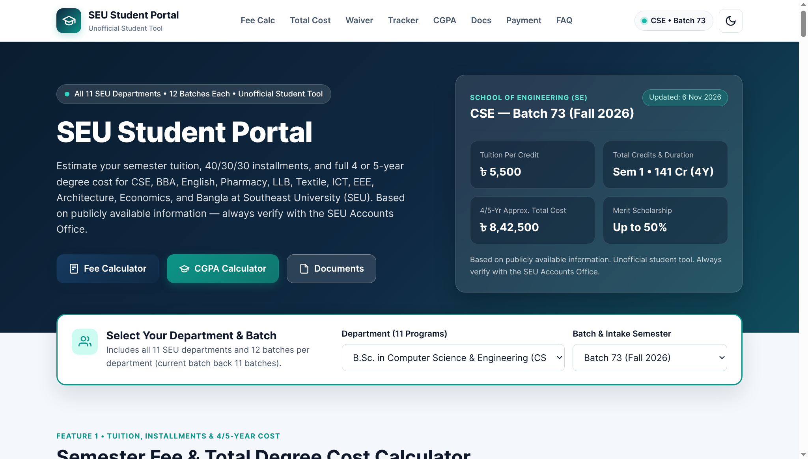
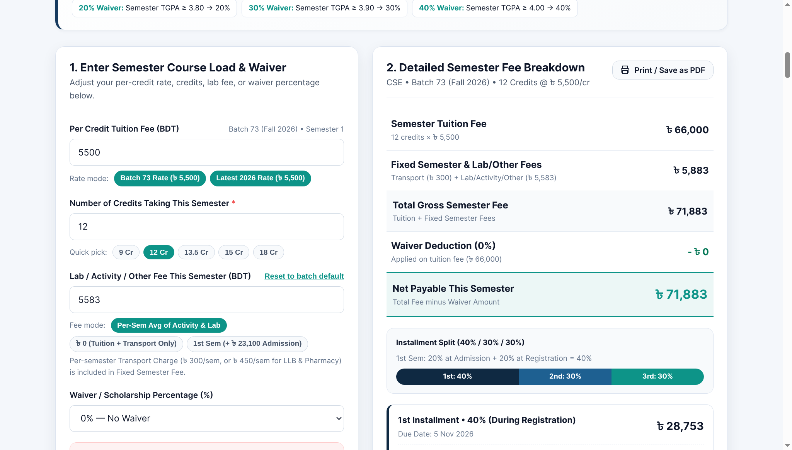
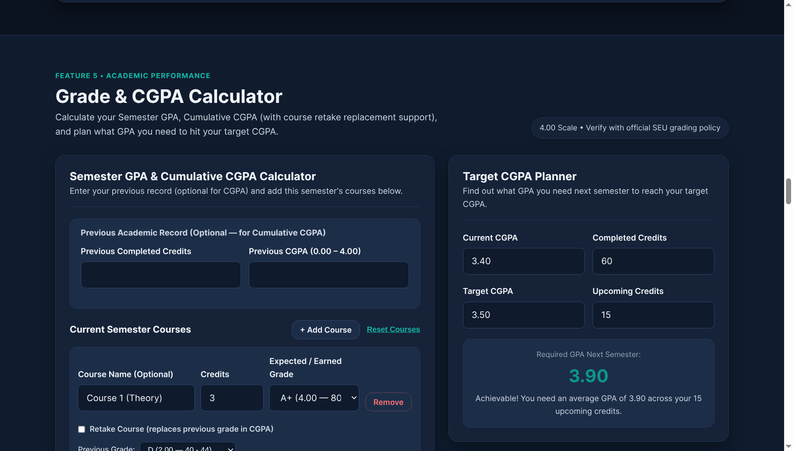

# SEU Student Portal

A responsive, static web portal for **Southeast University (SEU), Bangladesh** students. Built with **plain HTML, CSS, and vanilla JavaScript** — no frameworks, no backend, and ready for deployment on **Netlify**.

> **Disclaimer:** Based on publicly available information. Unofficial student tool. Always verify with the SEU Accounts Office.

- **Live Demo:** `https://seu-student-portal.netlify.app` *(update with your live Netlify URL after deployment)*
- **Issue Tracker:** [https://github.com/mahfuz10-max/seu-student-portal/issues](https://github.com/mahfuz10-max/seu-student-portal/issues)
- **Contact / Feedback:** `mdmustafizurr19@gmail.com`

---

## Project Screenshots

### 1. Hero Section & Global Department / Batch Selector


### 2. Semester Fee Calculator & 40/30/30 Installment Breakdown


### 3. Grade / CGPA Calculator & Target CGPA Planner (Dark Mode)


---

## Features

1. **Global Department & Batch Selector**
   - Covers all **11 undergraduate departments** (`CSE`, `BBA`, `English`, `Pharmacy`, `LLB`, `Textile`, `ICT`, `EEE`, `Architecture`, `Economics`, and `Bangla`) and **12 batches per department** (132 batches in total, from the latest intake back 11 batches).
   - Automatically filters batches by department, syncs across all sections, and remembers your choice in `localStorage`.
2. **Semester Fee & 4/5-Year Total Degree Cost Calculator**
   - Displays batch-specific per-credit tuition rates, fixed semester charges, one-time activity and laboratory fees, waiver rules, and `Data last updated` date.
   - Calculates Semester Tuition (`credits × perCreditFee`), Total Gross Fee, Waiver Deduction (configurable as `"tuition"` or `"total"`), Net Payable, and the **3 installments (40% / 30% / 30%)** where any `৳ 1` rounding difference is placed in the 3rd installment so all 3 installments sum exactly to Net Payable.
   - Estimates the full **4 or 5-Year Degree Total Cost** before and after waiver, plus an **All-Departments Comparison Table**.
3. **Waiver Eligibility Checker**
   - Compares your SSC GPA, HSC GPA, and/or previous Semester TGPA/CGPA against your batch's `waiverRules` in `data/departments.json`.
   - Shows your eligible waiver percentage, exact savings in Taka (`৳`), and the next higher waiver tier with how much more GPA/TGPA is needed to reach it.
4. **Semester Installment Payment Tracker & Due Date Countdown**
   - Checklist for the 1st (40%), 2nd (30%), and 3rd (30%) installments with optional Payment Date and Receipt / TrxID notes stored privately in `localStorage` per `department + batch`.
   - Formats installment due dates as human-readable dates (e.g., `5 Nov 2026`), highlights overdue unpaid installments in red, and displays a live countdown banner.
5. **Grade / CGPA Calculator & Target CGPA Planner**
   - Uses the 4.00 grading scale from `data/grades.json` (`A+` 4.00 down to `F` 0.00).
   - Calculates Semester GPA (SGPA) and Cumulative CGPA with **Retake Course** replacement support, warns inline if any course row has an empty or invalid credit value, and includes a **Target CGPA Planner**.
6. **Batch Documents (`available: true / false`)**
   - Lists 6 document categories per batch (`Academic Calendar`, `Fee Structure`, `Waiver Policy`, `Class Routine`, `Syllabus & Course Plan`, and `Exam Routine`).
   - Documents with `"available": false` are displayed as disabled cards labelled **"Not uploaded yet"** with no broken or fake download links.
7. **Payment Method Guide & Searchable FAQ**
   - General step-by-step guidance for Bank Deposit, bKash, Nagad, Rocket, and On-Campus Booth payments from `data/payment-methods.json`, plus a searchable FAQ accordion from `data/faq.json`.

---

## Known Limitations

- **No Official PDF Documents Included Yet:** All document entries in `data/departments.json` default to `"available": false` and render as `"Not uploaded yet"` until real PDF files obtained from the university are added to `documents/<dept>/<batch>/`.
- **Payment Account & Merchant Details:** Official bank account numbers and mobile banking biller/merchant IDs are intentionally omitted for student safety and must be confirmed directly with the **SEU Accounts Office** or UMS portal.
- **Fee & Due Date Verification:** Tuition rates, historical batch fee progressions, scholarship continuation rules, and installment deadlines are compiled from publicly available information and may change by university notice. Always verify with the **SEU Accounts Office**.

---

## Folder Structure

```text
/
├── index.html                        # Main single-page application HTML
├── css/
│   └── style.css                     # Responsive stylesheet & dark mode variables
├── js/
│   ├── app.js                        # Main controller, JSON loader, global selector, docs, FAQ
│   ├── fee.js                        # Semester Fee, 40/30/30 Installments & 4/5-Year Cost Calculator
│   ├── waiver.js                     # Waiver Eligibility Checker
│   ├── tracker.js                    # Payment Tracker & Due Date Countdown
│   └── grade.js                      # Semester GPA, CGPA, Retake & Target CGPA Planner
├── data/
│   ├── departments.json              # 11 departments × 12 batches (132 batches), fees, waivers & docs
│   ├── grades.json                   # 4.00 grading scale
│   ├── payment-methods.json          # General payment guidance
│   └── faq.json                      # Frequently asked questions & answers
├── screenshots/                      # Real project screenshots displayed in README.md
│   ├── hero-and-fee-calculator.png
│   ├── waiver-and-payment-tracker.png
│   └── cgpa-and-dark-mode.png
├── documents/                        # Place real PDFs under documents/<dept>/<batch>/
│   └── <dept>/<batch>/               # e.g., documents/cse/73/academic-calendar.pdf
│                                     # 11 departments: cse, bba, english, pharmacy, llb,
│                                     # textile, ict, eee, architecture, economics, bangla
│                                     # 6 document types per batch:
│                                     #   - academic-calendar.pdf
│                                     #   - fee-structure.pdf
│                                     #   - waiver-policy.pdf
│                                     #   - class-routine.pdf
│                                     #   - syllabus-course-plan.pdf
│                                     #   - exam-routine.pdf
└── README.md                         # Project documentation, screenshots & data editing guide
```

---

## How to Update Data & Upload Real PDFs

All portal data is stored in `/data/*.json`.

### 1. Uploading a Real PDF Document (`documents/` & `data/departments.json`)
By default, every document entry in `data/departments.json` has `"available": false`, which shows a disabled **"Not uploaded yet"** badge on the website. To make a document downloadable:
1. Copy the real PDF file into the matching folder, for example:
   `documents/cse/73/academic-calendar.pdf`
2. Open `data/departments.json`, find that batch's entry inside `"documents"`, and change `"available": false` to `"available": true`:
   ```json
   {
     "title": "CSE Batch 73 — Academic Calendar",
     "description": "Semester dates, installment deadlines, midterm, and final exam schedule.",
     "file": "documents/cse/73/academic-calendar.pdf",
     "available": true
   }
   ```
3. Save `data/departments.json`. The card will automatically enable the **Download / View PDF** button.

### 2. Updating Batch Fees, Due Dates & Waiver Rules (`data/departments.json`)
Each batch inside a department's `"batches"` array supports:
- `"perCreditFee"`: Tuition fee per credit in BDT (e.g., `5500`).
- `"semesterFee"`: Fixed per-semester charge in BDT (e.g., `300` transport charge, or `450` for LLB/Pharmacy).
- `"labFee"` / `"avgOneTimePerSem"`: Default per-semester lab/activity fee auto-filled in the calculator.
- `"totalCredits"`, `"durationYears"`, `"totalSemesters"`, `"activityFeeOneTime"`, `"labFeeOneTime"`, `"nonCreditOrVendorFee"`, `"approxTotalCost"`: Used by the 4/5-Year Total Degree Cost calculator.
- `"installmentDates"`: Array of 3 ISO date strings (`["YYYY-MM-DD", "YYYY-MM-DD", "YYYY-MM-DD"]`), formatted automatically in the UI as `"5 Nov 2026"`. Leave as `["", "", ""]` if not announced yet.
- `"waiverRules"`: Array of waiver rules (`"hsc_gpa"`, `"ssc_gpa"`, `"combined_gpa"`, or `"semester_cgpa"`).

### 3. Updating Payment Guidance (`data/payment-methods.json`) & FAQs (`data/faq.json`)
- Edit `data/payment-methods.json` to update `"accountValue"`, `"referenceFormat"`, `"steps"`, and `"notes"` once confirmed with the SEU Accounts Office.
- Edit `data/faq.json` to add or revise questions and answers in the `"faqs"` array.

---

## Running Locally & Deploying on Netlify

### Running Locally
Run a local HTTP server from the project root so the browser can `fetch()` the `/data/*.json` files:
```bash
python3 -m http.server 8000
```
Then open `http://localhost:8000` in your browser.

### Deploying on Netlify
1. Push this project folder to GitHub or drag and drop the folder into [Netlify Drop](https://app.netlify.com/drop).
2. If deploying from GitHub, leave **Build command** empty and set **Publish directory** to `.` (or `/`).
